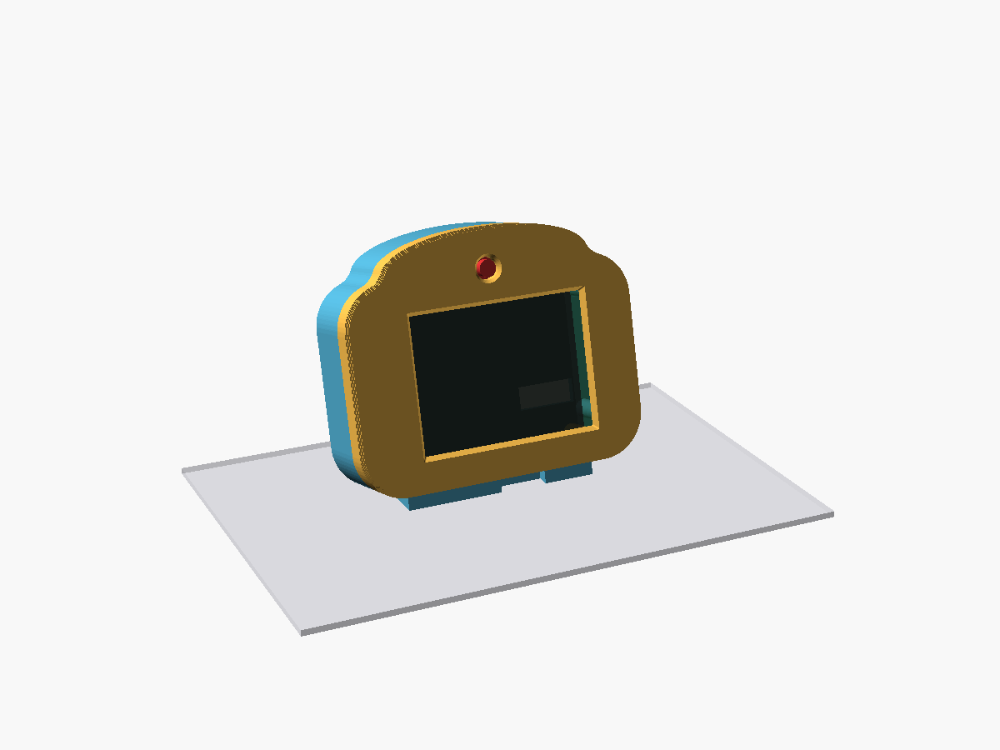

# MadBuddy

MadBuddy ist ein kleines Haustier mit großen Augen auf dem ESP32-2432S028 („Cheap Yellow Display“, CYD). Es schaut sich um, freut sich über Streicheln, langweilt sich, schläft im Dunkeln und reagiert auf Tageszeit und Wetter. Mit der Kamera-Erweiterung sieht es dich: Es begrüßt dich, folgt dir mit den Augen und schläft ein, wenn du gehst.

<table>
  <tr>
    <td align="center"> Gesichtsausdrücke</td>
    <td align="center"> Stufe 2: Desktop-Kopf</td>
    <td align="center"> Stufe 3: Roboter</td>
  </tr>
</table>

## 📄 Anleitungen

| | Anleitung |
|---|---|
| 📷 | **[Kamera und XIAO in den Roboter einbauen (PDF, mit Bildern)](docs/einbau-kamera-roboter.pdf)** |
| 🔌 | [Verkabelung CYD ↔ Kamera-Platine (Grafik, Pinbelegung, Löten)](docs/verkabelung.md) |
| 🖨️ | [Druckteile, Schrauben und Montagereihenfolge](case/README.md) |
| 🔄 | [Online-Update](docs/ota.md) |
| 🤖 | [Claude-Modus einrichten](tools/claude-hooks/README.md) |

## Drei Ausbaustufen

| | 1 „Pur“ | 2 „Desktop-Kopf“ | 3 „Roboter“ |
|---|---|---|---|
| Aufbau | nacktes CYD am USB | Gehäuse „Kopf mit Stirn“ (15°-Fuß) | sitzender Roboter |
| Kamera | nein | XIAO ESP32S3 Sense in der Stirn | XIAO in der Brust |
| Strom | USB-Netzteil | USB-C (nur Kabel USB-A auf USB-C) | Akku 2×18650 im Po/in den Beinen, Laden per USB-C im Boden |
| Löten | nein | 4 Drähte | Leitungen, Schalter |
| 3D-Druck | nein | ja (PETG) | ja (PETG) |
| Stand | ✅ läuft | 🟡 Gehäuse druckbar, Fenster im Testdruck | 🟡 druckbar, Maße des Akkumoduls vorläufig |

**Kamera-Firmware:** 🟡 läuft am Gerät (Verbindung, Augen-Symbol, Einstellungen, Update über das Release). Die Gesichtserkennung wird noch abgestimmt (Licht, Einbaulage, Blickrichtung).

## Einkaufsliste

Preise: ca., Stand Oktober 2026, ohne Versand. „Schätzung“ = nicht belegt. Wo kein Link steht, ist ein Suchbegriff angegeben (nicht geprüft).

### Stufe 1 „Pur“

| Menge | Teil | Typ/Bezeichnung | ca. Preis | Bezugsquelle |
|---|---|---|---|---|
| 1 | CYD | ESP32-2432S028, 2,8" mit Touch, **Variante mit 2 USB-Buchsen (Micro-USB + USB-C)** | 15 € | `ESP32-2432S028 2.8 inch USB-C` (AliExpress/eBay); Kaufhinweise: [Projektseite Cheap Yellow Display](https://github.com/witnessmenow/ESP32-Cheap-Yellow-Display) |
| 1 | USB-Kabel | USB-A auf USB-C oder Micro-USB, mit Daten | 3 € (Schätzung) | `USB-A auf USB-C Kabel` |
| 1 | USB-Netzteil | 5 V | 8 € (Schätzung) | `USB Netzteil 5V 1A` |

Summe ca. 25 €.

### Stufe 2 „Desktop-Kopf“ (kommt zu Stufe 1 dazu)

| Menge | Teil | Typ/Bezeichnung | ca. Preis | Bezugsquelle |
|---|---|---|---|---|
| 1 | Kamera-Platine | Seeed XIAO ESP32S3 Sense, **ohne Header** | 14 € (Seeed, 13,99 US-$) bis 24 € (Händler in DE) | [Seeed](https://www.seeedstudio.com/XIAO-ESP32S3-Sense-p-5639.html); [Eckstein](https://eckstein-shop.de/Seeed-Studio-XIAO-ESP32S3-Sense-with-OV2640-Camera-Sensor-EN) (23,95 €) |
| 2 | Kabel/Stecker | 1,25 mm 4-Pin Kabel mit Stecker, einseitig offen (je eines für P1 und CN1 des CYD, ca. 80 bis 100 mm). Vor dem Bestellen Steckerlage und Pin 1 am eigenen Board prüfen, siehe [Verkabelung](docs/verkabelung.md) | 3 € (Schätzung) | `1.25mm 4 Pin Kabel Stecker` |
| 4 | Schrauben | M3×8 Zylinderkopf (DIN 912), selbstschneidend in PETG | 3 € (Schätzung) | `M3x8 DIN 912 Schrauben` |
| ca. 100 g | Filament | PETG (Verbrauch geschätzt) | 3 € (Schätzung; Rolle 1 kg ca. 20 €) | `PETG Filament 1,75 mm` |
| 1 | Netzteil | 5 V, ≥ 1 A (die Kamera hängt mit am Kabel) | 8 € (Schätzung) | `USB Netzteil 5V 2A` |
| 1 | Kabel | **USB-A auf USB-C** (Kabel C auf C liefert keinen Strom, siehe unten) | 3 € (Schätzung) | `USB-A auf USB-C Kabel` |

Summe zusätzlich ca. 35–45 €. Netzteil und Kabel aus Stufe 1 lassen sich oft weiterverwenden, wenn das Netzteil mindestens 1 A liefert.

### Stufe 3 „Roboter“ (kommt zu Stufe 2 dazu, Netzteil und Kabel dienen nur noch zum Laden)

| Menge | Teil | Typ/Bezeichnung | ca. Preis | Bezugsquelle |
|---|---|---|---|---|
| 1 | Akkuhalter mit Ladeschaltung | DFRobot DFR0969 „2-Way 18650 Battery Holder“: 2 Zellen, Laden per Micro-USB/USB-C, 5-V-Ausgang 2 A, DIP-Schalter HOLD/NORMAL | 9,90 US-$ | [DFRobot](https://www.dfrobot.com/product-2578.html) |
| 2 | Akkuzellen | 18650 Li-Ion, **Markenzellen** (keine No-Name-Zellen mit Fantasie-Kapazität) | 12 € (Schätzung) | `18650 Akku Samsung Sony Murata` |
| 1 | Schalter | kleiner Schiebeschalter | 2 € (Schätzung) | `Mini Schiebeschalter SPDT` |
| 1 | Litze | dünn, für 5 V/GND | 3 € (Schätzung) | `Litze 0,25 mm²` |
| 2 | Kabel/Stecker | 1,25 mm 4-Pin Kabel mit Stecker, einseitig offen, **ca. 150 mm** (länger als in Stufe 2, durch den Hals; Länge vorläufig) | 3 € (Schätzung) | `1.25mm 4 Pin Kabel Stecker 150mm` |
| 20 | Schrauben | M3: 4× M3×8, 12× M3×10 (davon 8 Flachkopf), 4× M3×28 (Liste mit Belegen in [`case/README.md`](case/README.md#schrauben-m3)) | 3 € (Schätzung) | `M3 Schrauben Set` |
| ca. 150 g | Filament | PETG, zusätzlich (geschätzt) | 4 € (Schätzung) | `PETG Filament 1,75 mm` |

Summe zusätzlich ca. 35 € (vorläufig).

### Werkzeug

- Lötkolben (ab Stufe 2)
- 3D-Drucker, der PETG druckt (ab Stufe 2)
- PC mit PlatformIO / VS Code

## So baust du ihn

### Stufe 1: flashen

1. CYD per USB-Kabel an den PC anschließen.
2. Flashen: `pio run -e cyd2usb -t upload`
3. **Touch einrichten:** Beim ersten Start (oder mit dem Finger auf dem Display beim Einschalten) die vier Pfeile in den Ecken antippen. Die Werte bleiben gespeichert.
4. **WLAN:** Beim ersten Start (und wenn 30 s kein WLAN da ist) öffnet der Buddy den Access-Point **„MadBuddy“**. Mit dem Handy verbinden, WLAN wählen, im Feld **„Ort“** den Wohnort eintragen (z. B. „Berlin“), speichern. Aus dem Ort werden die Koordinaten für das Wetter (Open-Meteo) bestimmt.

### Stufe 2: Desktop-Kopf

1. **XIAO vor dem Einbau flashen** (`& tools\cam-build.ps1`, dann per Kabel). Sein USB-C ist im Gehäuse nicht erreichbar; spätere Updates kommen über das Release (siehe unten).
2. **Drucken** (PETG, 0,2 mm, 3 Wände, ohne Stützen): zuerst `frame_test` (ca. 20 min, prüft Fenster, Glas-Sitz, Lochbild), dann `front`, `back` und `cam_clip`. STL-Dateien unter [`case/stl/`](case/stl/).
3. **Verdrahten** nach der [Verkabelung](docs/verkabelung.md): 4 Adern, P1 VIN → XIAO 5V, P1 GND → XIAO GND, CN1 IO27 ↔ D6, CN1 IO22 ↔ D7.
4. **Kamera und XIAO einbauen** ([`case/README.md`](case/README.md#kamera-und-xiao-einbauen-stufe-2)), mit 4× M3×8 verschrauben.

> ⚠️ Lage und Pin 1 von P1 und CN1 vor dem Löten am eigenen Board prüfen, und die Spannung an P1 VIN messen, bevor du die Kamera anschließt (Schritt in der Verkabelungsanleitung).

> ⚠️ **Strom:** USB-C nur mit Kabel **USB-A auf USB-C**. Dem USB-C des CYD fehlen die CC-Widerstände, ein Kabel C auf C liefert keinen Strom. Das Netzteil braucht ca. 1 A, weil die Kamera mitläuft.

### Stufe 3: Roboter

Sitzende Roboterfigur: Kopf mit CYD, Kamera in der Brust, Akku (DFR0969, 2×18650) in Po und Beinen, Laden per USB-C im Boden. Ein Schiebeschalter im Boden schaltet CYD und Kamera. Laufzeit etwa 7–9 h (Schätzung).

1. **Drucken:** [`case/3mf/roboter_teile.3mf`](case/3mf/roboter_teile.3mf) (alle Teile getrennt) bzw. [`case/3mf/roboter_ams.3mf`](case/3mf/roboter_ams.3mf) (Kopf mit Blende und Zierschrauben mehrfarbig). PETG, 0,2 mm, ohne Stützen.
2. **XIAO vor dem Einbau flashen** (wie Stufe 2).
3. **Verdrahten:** [Verkabelung Stufe 3](docs/verkabelung.md#stufe-3-roboter) (Kabel ca. 150 mm durch den Hals, Strom vom Schalter zu CYD und XIAO).
4. **Zusammenbauen** nach der [Montagereihenfolge](case/README.md#montagereihenfolge). Für die Kamera: **[📷 Einbauanleitung mit Bildern (PDF)](docs/einbau-kamera-roboter.pdf)**.

> ⚠️ Den DIP-Schalter am Akkumodul fest auf **HOLD** stellen, sonst schaltet es bei wenig Last ab.
> **Zum Flashen per Kabel den Schalter auf Aus stellen.** Laut Schaltplan sind USB-5V und VIN (P1) am CYD gegeneinander entkoppelt (aus dem Schaltplan gelesen, nicht am Gerät gemessen).

## Bedienung

| Geste | Wirkung |
|---|---|
| **Tippen** | kurz überrascht, ein bisschen Unterhaltung |
| **Streicheln** (Finger über das Display ziehen) | verliebt, Herzchen (höchstens alle 2 s) |
| **Stupsen** (5 Tipps in 3 s) | genervt, 20 s rote, böse Augen |
| **High-Five** (Tipp in eine obere Ecke) | Hand in der Ecke, LED blitzt weiß |
| **Finger auflegen / ziehen** | die Augen folgen dem Finger (3 s) |
| **Lang drücken** (> 1,2 s) | Menü |

**Menü** (2×3 Kacheln, schließt nach 10 s ohne Eingabe): Spielen (Fang mich, Simon) · Apfel (Füttern) · Sanduhr (Timer) · Uhr · Zahnrad (Einstellungen) · Zurück.

- **Uhr:** Uhrzeit, Datum, Wetter für 15 s; Antippen schließt.
- **Fang mich:** ein kleines Auge springt herum, 20 s; ab 8 Treffern gewonnen.
- **Simon:** Folge der vier Farbfelder nachtippen; Länge 6 = gewonnen.
- **Füttern:** Apfel, Pizza, Kuchen, Kaffee; oben der Sättigungsbalken. Er hat ein (zufälliges) Lieblingsessen; zu viel macht Bauchweh.
- **Timer (Pomodoro):** 15, 25 oder 45 min Arbeit, dann 5 min Pause. Ein Ring am Rand zeigt den Fortschritt. Pause: LED blinkt 5× grün, Ende: 2× blau.
- **Einstellungen Seite 1:** Helligkeit (3 Stufen), WLAN/Ort (öffnet das Portal), Firmware (Stand; Tippen sucht ein Update), Info (Version, freier Speicher, Lichtsensor, Charakter-Balken).
- **Einstellungen Seite 2 (Pfeil rechts unten):** Kamera an/aus und Kamera-Status (grün verbunden, gelb keine Verbindung, rot Fehler).

**Kamera:** Das Augen-Symbol im Statusstreifen zeigt den Zustand (grau = niemand da, grün = Gesicht erkannt, rot = Fehler). Siehst du ihn an, begrüßt er dich und die Augen folgen dir; kommst du ganz nah, schielt er. Gehst du, schläft er nach einer Weile ein.

**Sprechblasen:** Höchstens alle 90 s sagt er etwas. Morgens begrüßt er dich mit dem Tageswetter, um 20 Uhr zeigt er den **Tagesrückblick** (Tippen schließt), um 22 Uhr gähnt er „Gute Nacht“.

**Hunger, Krankheit, Charakter:** Wird er nicht gefüttert, wird er hungrig. Ist er 2 Stunden lang sehr hungrig und ungeliebt, wird er krank (blass, „Hatschi“). Heilen: satt füttern, dann 3× streicheln. Sterben kann er nicht. Dein Umgang prägt den Charakter: viel Streicheln macht ihn verschmust, Stupsen frech, Spielen verspielt.

**Schlaf:** Nachts (22–7 Uhr) schläft er nach 10 min ohne Berührung ein (Hintergrundlicht 10 %). Ist seine Energie fast leer, macht er ein Nickerchen; eine Berührung weckt ihn.

## Claude-Modus

Mit Claude-Code-Hooks auf dem PC zeigt der Buddy, was Claude gerade tut:

- „Okay!“ beim Auftrag, nachdenklich (orange) beim Denken
- Pupillen huschen beim Lesen, Tipp-Punkte beim Schreiben, drehender Ring bei Befehlen
- „Mist!“ bei Fehlern
- **Blick + gelbe LED „Hey, du!“, wenn Claude dich braucht**
- High-Five „Fertig!“ am Ende

Oranger Funke im Statusstreifen = Sitzung aktiv (daneben die Zahl der Helfer). 15 min ohne Ereignis = wieder Haustier. Der Schlüssel steht unter Einstellungen → Info. Einrichtung: [`tools/claude-hooks/README.md`](tools/claude-hooks/README.md).

## Online-Update

Liegt eine neue Firmware im GitHub-Release, erscheint die Karte „Update bereit“. *Ja* lädt und startet neu, *Später* fragt in einer Stunde wieder. Enthält das Release auch eine neue Kamera-Firmware, bietet die Karte sie in einer eigenen Zeile an; der CYD reicht sie über die Leitung an den XIAO weiter. Details: [`docs/ota.md`](docs/ota.md).

## Entwicklung

- Bauen: `pio run -e cyd2usb`; Kamera (XIAO): `& tools\cam-build.ps1` (baut außerhalb der Dropbox)
- Flashen (erstes Mal per Kabel): `pio run -e cyd2usb -t upload`
- Tests (am PC): `pio test -e native` (Logik unter `src/logic/`) und `node --test tools/gen-phrases.test.mjs tools/ota-publish.test.mjs`
- Gehäuse prüfen: `& case\check.ps1` (Desktop-Kopf), `& case\check_roboter.ps1` (Roboter); Anleitungsbilder: `& case\tools\render_guide.ps1`
- Sätze: `docs/superpowers/specs/2026-10-25-saetze.json` → `node tools/gen-phrases.mjs` erzeugt `src/logic/phrases.h` (mit committen; `--check` prüft, ob er aktuell ist)
- Veröffentlichen (nur lokal): `pio run -e cyd2usb && node tools/ota-publish.mjs --release`
- Seriell (115200): alle 60 s `heap=… min=… fps=… emo=…`

Aufbau: reine, am PC getestete Logik in `src/logic/*.h` (keine Arduino-Includes, Zeit als Parameter); Hardware in `src/hw/`, Bildschirme in `src/ui/`, Netz in `src/net/` (eigener Task auf Kern 0), Update in `src/ota/`; `src/app.cpp` verbindet alles. Kamera-Firmware für den XIAO in `cam/`. Pins und Messwerte (Panel, Touch-Kalibrierung, Lichtsensor) stehen in `src/config.h`.

Design und Pläne: `docs/superpowers/`, Fortschritt: [`docs/FORTSCHRITT.md`](docs/FORTSCHRITT.md).
