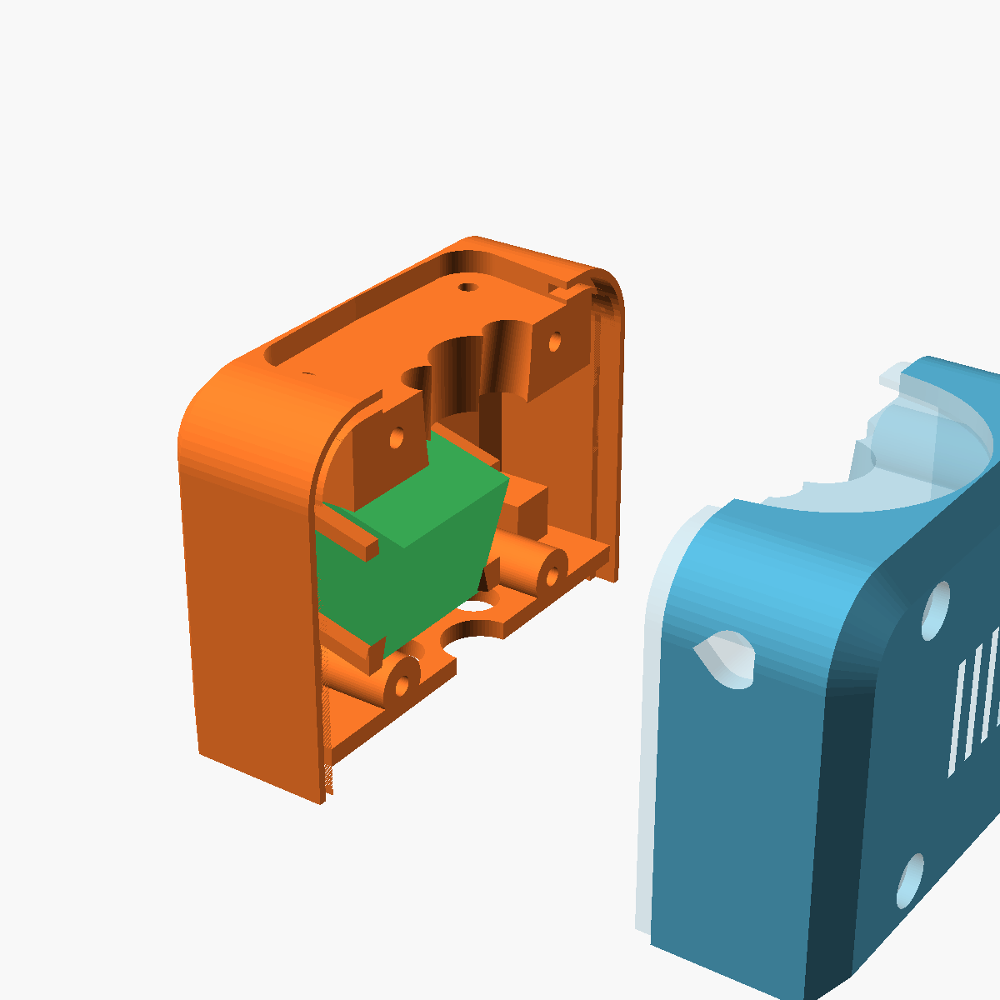

# Kamera und XIAO in den Roboter einbauen

Die Kamera sitzt innen in der Brust des Roboters. Sie schaut durch ein kleines Loch (Ø 6,7 mm) nach vorn. Gehalten wird sie ohne Kleber und ohne Schrauben: ein flaches Druckteil, der **Riegel**, klemmt sie fest. Der XIAO darunter rastet zwischen vier Pfosten ein.

Alle Bilder zeigen den Oberkörper-Vorderteil `torso_front` **von hinten**, also so, wie er vor dir liegt, wenn die Rückwand ab ist.

## Was du brauchst

| Teil | Woher |
|---|---|
| `torso_front` (Vorderteil Oberkörper) | [`case/stl/roboter_torso_front.stl`](../case/stl/) bzw. `roboter_teile.3mf` |
| `cam_clip` (Riegel, 1×) | [`case/stl/roboter_cam_clip.stl`](../case/stl/roboter_cam_clip.stl), auch in `roboter_teile.3mf`. Flach drucken, 3 Wände |
| `torso_back` (Rückwand Oberkörper) | `roboter_teile.3mf` |
| Kameramodul (OV3660, liegt dem XIAO Sense bei) | – |
| XIAO ESP32S3 Sense, Kameraplatine aufgesteckt, Drähte schon angelötet | siehe [Verkabelung](verkabelung.md#stufe-3-roboter) |
| 4 × Schraube M3×28 | – |

**Vorher:** Hals und Kopf sind schon auf `torso_front` montiert (Schritte 1 und 2 der [Montagereihenfolge](../case/README.md#montagereihenfolge)). Die Rückwand `torso_back` ist **ab**. Bei geschlossenem Oberkörper kommst du nicht an die Tasche.

**Tipp:** Die Kamera einmal am CYD testen, bevor du den Oberkörper schließt.

## Die Begriffe

- **Tasche:** das kleine quadratische Kästchen in der Mitte. Es liegt innen an der Brust, vorn ist das Linsenloch.
- **Nuten:** zwei schmale Schlitze links und rechts im Rand der Tasche. Darin gleitet der Riegel.
- **FPC-Schlitz:** eine Seite der Tasche ist offen. Dort läuft das Flachkabel der Kamera heraus. Von hinten gesehen ist das die **linke** Seite.
- **Pfosten:** die vier schrägen Stege um die Tasche. Zwischen ihnen sitzt später der XIAO. Ihre Enden haben kleine Lippen, die einrasten.

## Schritt 1: Kamera in die Tasche

1. Kamera so halten, dass die Linse nach vorn zeigt, also vom Betrachter weg ins Loch.
2. Das Flachkabel zeigt nach **links**, zum offenen Schlitz.
3. Kamera gerade in die Tasche drücken, bis der quadratische Körper vorn anliegt. Die Linse steckt dann im Loch.

Die Tasche hat 0,25 mm Spiel je Seite. Die Kamera fällt also hinein, sitzt aber noch lose.

## Schritt 2: Riegel einschieben

1. Den Riegel (flaches U, 1,2 mm dick) von **links**, also von der Kabelseite, in die beiden Nuten schieben. Der geschlossene Quersteg geht voran, die offene Seite des U zeigt zu dir nach links.
2. Das Flachkabel liegt zwischen den beiden Armen des U und wird nicht eingeklemmt.
3. Schieben, bis der Quersteg auf der anderen Seite am Rand der Tasche anliegt. Der Riegel drückt die Kamera nach vorn gegen die Wand.

Der Riegel klemmt mit 0,1 mm Übermaß. Er geht stramm, Kleber brauchst du nicht. Geht er gar nicht rein, die Arme mit feinem Schleifpapier leicht dünner schleifen. Sitzt er zu locker, hilft ein dünnes doppelseitiges Klebepad hinten auf der Kamera.

## Schritt 3: XIAO einrasten

1. Flachkabel in den Klappstecker der Kameraplatine (Sense) stecken und den Bügel schließen. Das Kabel macht eine lockere Schleife und wird **nicht geknickt**.
2. XIAO-Stapel so drehen, dass die Kameraplatine nach vorn zur Kamera zeigt und der Stecker zur Tasche.
3. Den Stapel von hinten gerade zwischen die vier Pfosten drücken, bis die Lippen hörbar über die Rückseite schnappen.

Die langen Seiten des XIAO bleiben frei, dort sitzen die angelöteten Drähte. Die Drähte zum Kopf laufen nach oben durch den Hals.

## Schritt 4: Rückwand schließen

1. `torso_back` gerade von hinten aufschieben. Keine Drähte einklemmen.
2. Mit 4 × M3×28 verschrauben.

Innen in der Rückwand sitzen ein Klemmsteg und eine Stützwand. Sie liegen dann direkt hinter dem XIAO, so dass er nicht herausfallen kann.

Danach geht es mit Schritt 4 der [Montagereihenfolge](../case/README.md#montagereihenfolge) weiter (Arme, Hände, Ohren).

---

Bilder neu erzeugen: `& case\tools\render_guide.ps1` (einzeln mit `-Only 3`). Die Einbauwege sind in `case/check_roboter.ps1` geprüft (`asm_cam`, `asm_clip`, `asm_stack`, `asm_close`).
