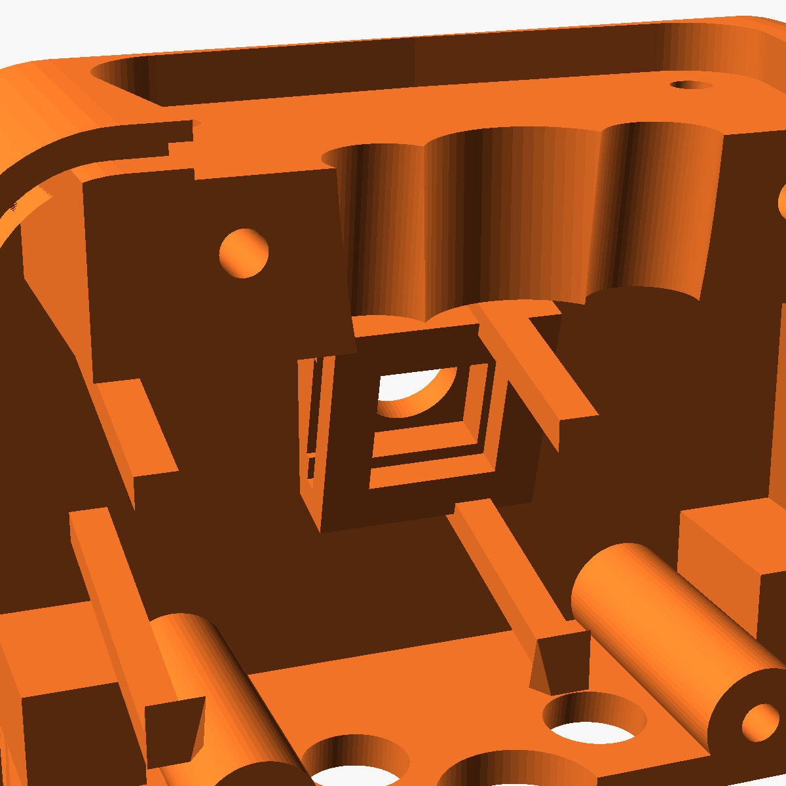
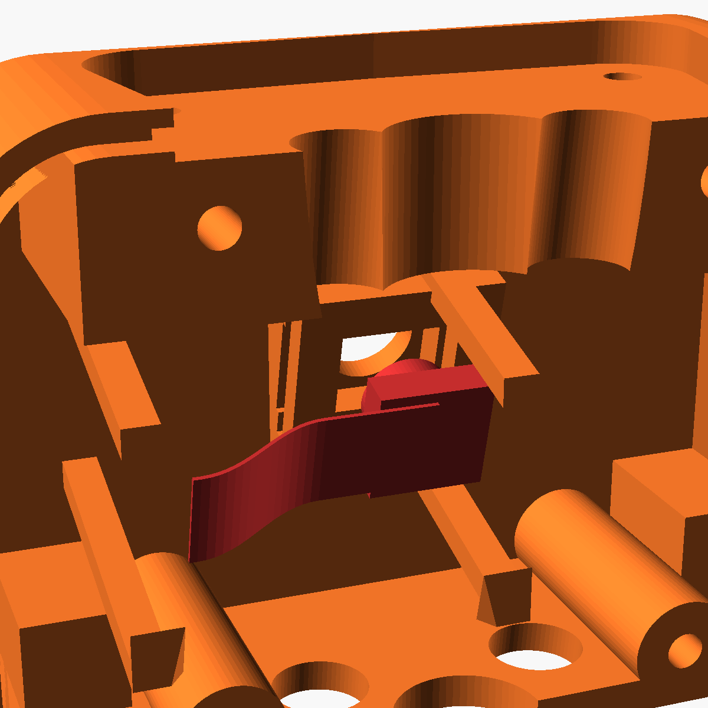
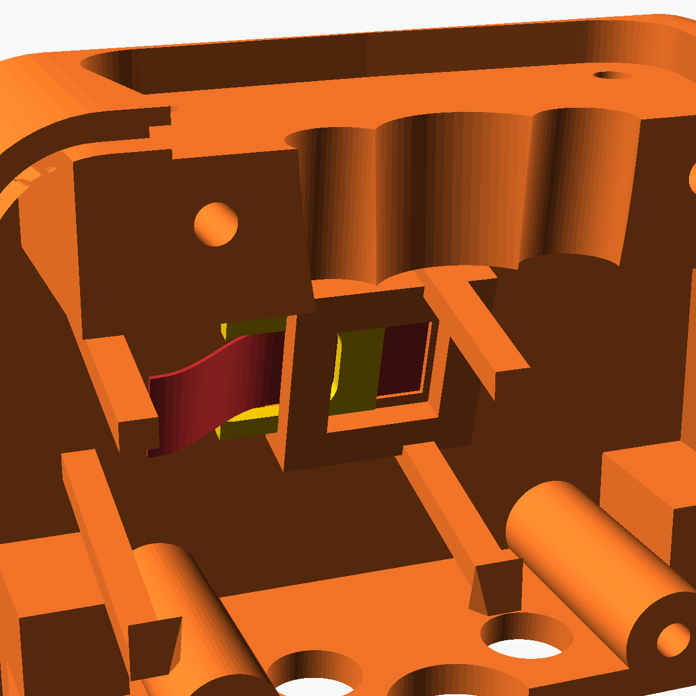
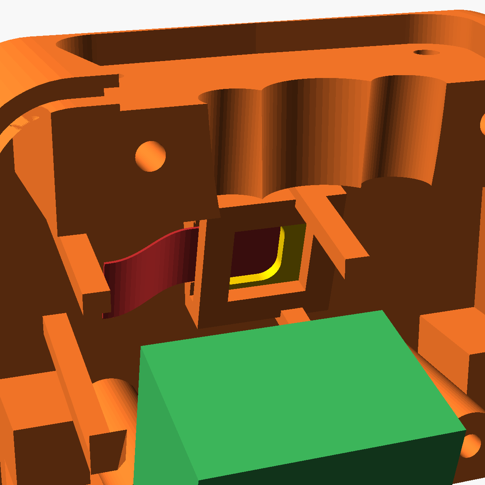

# Kamera und XIAO in den Roboter einbauen

Die Kamera sitzt innen in der Brust des Roboters. Sie schaut durch ein kleines Loch (Ø 6,7 mm) nach vorn. Kamera und XIAO bleiben **so, wie Seeed sie liefert**: Die Kameraplatine steckt auf dem XIAO über dem SD-Steckplatz. Beides wird als **ein Block** von hinten in die Brust geschoben. Nichts wird geklebt, nichts geschraubt, es gibt keinen Riegel.

Alle Bilder zeigen den Oberkörper-Vorderteil `torso_front` **von hinten**, also so, wie er vor dir liegt, wenn die Rückwand ab ist.

## Was du brauchst

| Teil | Woher |
|---|---|
| `torso_front` (Vorderteil Oberkörper) | [`case/stl/roboter_torso_front.stl`](../case/stl/) bzw. `roboter_teile.3mf` |
| `torso_back` (Rückwand Oberkörper) | `roboter_teile.3mf` |
| XIAO ESP32S3 Sense mit aufgesteckter Kamera (wie geliefert), Drähte schon angelötet | siehe [Verkabelung](verkabelung.md#stufe-3-roboter) |
| 4 × Schraube M3×28 | – |

**Zuerst `cam_test` drucken** (kleines Probestück, [`case/stl/roboter_cam_test.stl`](../case/stl/roboter_cam_test.stl)). Geht der Block dort stramm, aber ohne Gewalt hinein, passt auch `torso_front`.

**Vorher:** Hals und Kopf sind schon auf `torso_front` montiert (Schritte 1 und 2 der [Montagereihenfolge](../case/README.md#montagereihenfolge)). Die Rückwand `torso_back` ist **ab**. Bei geschlossenem Oberkörper kommst du nicht an die Tasche.

**Tipp:** Den XIAO samt Kamera einmal am CYD testen, bevor du den Oberkörper schließt.

## Schritt 1: Leere Tasche

- **Tasche:** das kleine quadratische Kästchen in der Mitte. Es liegt innen an der Brust, vorn ist das Linsenloch.
- **Schacht:** die Wände darum halten den XIAO seitlich. Der Block gleitet von hinten hinein.

Die Kamera wird **nicht** einzeln eingesetzt und **nicht** vom XIAO abgezogen.

## Schritt 2: Block von hinten einschieben

1. Die Kamera bleibt wie geliefert auf dem SD-Steckplatz des XIAO. Nichts kleben.
2. Block so halten, dass die Linse nach vorn zum Loch zeigt.
3. Gerade von hinten in Schacht und Tasche schieben, die Linse in das Loch.

Die angelöteten Drähte bleiben dabei frei. Sie laufen später nach oben durch den Hals.

## Schritt 3: Block sitzt

- Die Kamera liegt vorn an der Brustwand, der XIAO sitzt im Schacht.
- Der Block hat ca. 0,3 mm Spiel. Er wackelt leicht, das ist richtig. Gehalten wird er gleich von der Rückwand.
- Die Lötstellen am XIAO dürfen nirgends anliegen.

## Schritt 4: Rückwand drauf

1. Vorher einschalten und prüfen, ob die Kamera am Display erkannt wird.
2. `torso_back` gerade von hinten aufschieben. Keine Drähte einklemmen.
3. Mit 4 × M3×28 verschrauben.

Innen in der Rückwand sitzt ein Anschlag direkt hinter dem XIAO. Er hält den ganzen Block gegen die Brustwand.

Danach geht es mit Schritt 4 der [Montagereihenfolge](../case/README.md#montagereihenfolge) weiter (Arme, Hände, Ohren).

---

Bilder neu erzeugen: `& case\tools\render_guide.ps1` (einzeln mit `-Only 3`). Der Einbauweg ist in `case/check_roboter.ps1` geprüft (`asm_block`, `asm_close`).
